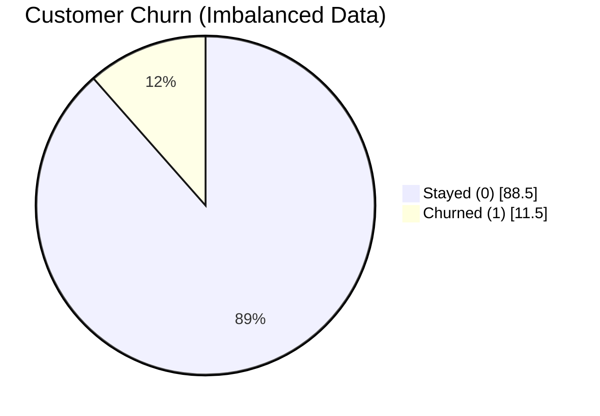
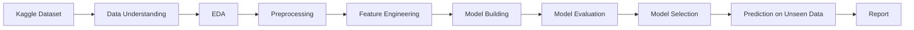
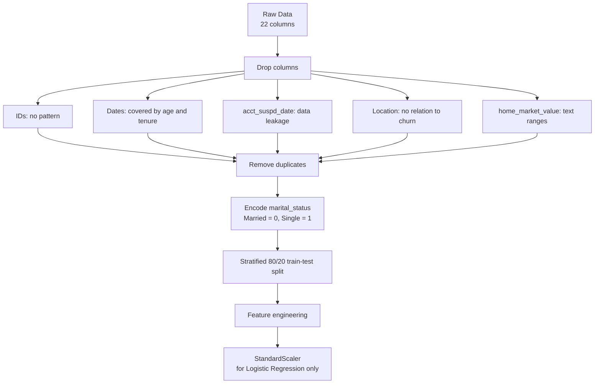
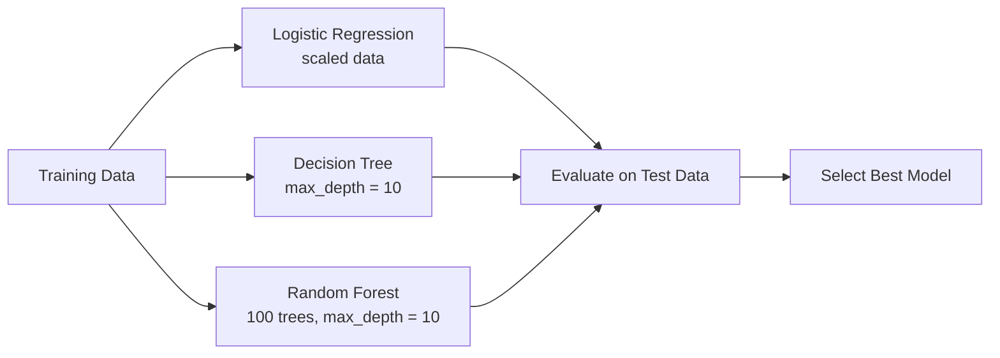
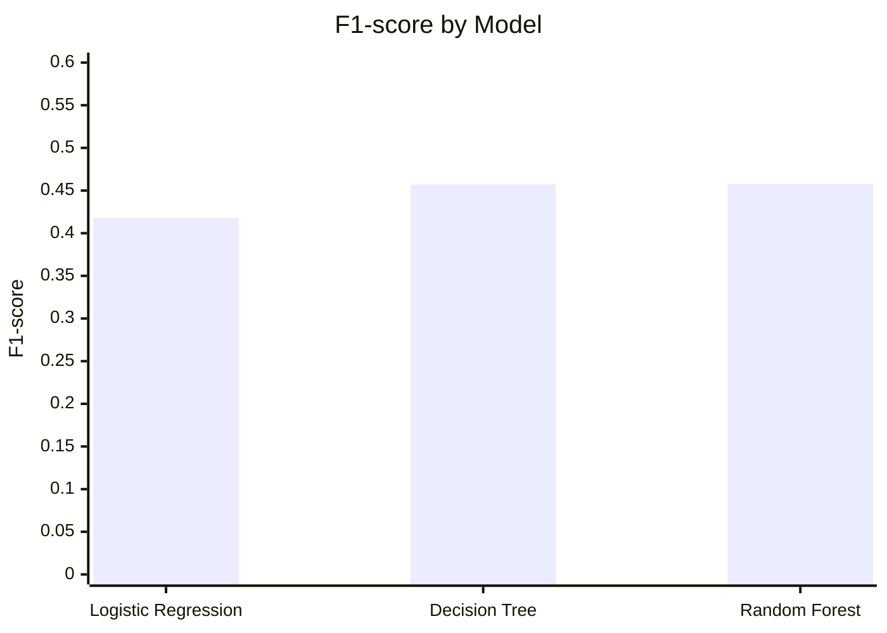
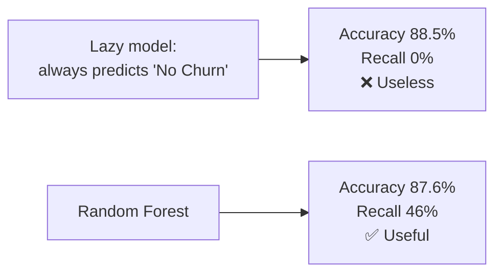
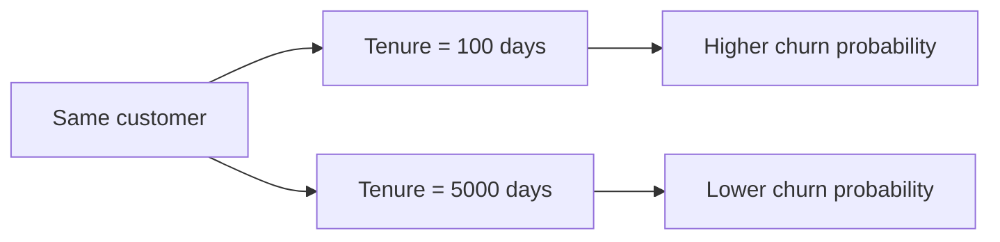

# 🛡️ Insurance Customer Churn Prediction

Predict which insurance customers are likely to **churn** (cancel or not renew their policy), so the company can step in early with retention offers.


---

## 📌 Problem Statement

Keeping an existing customer costs far less than winning a new one. This project builds a **binary classification** model that predicts whether a customer will churn:

- `Churn = 1` → customer left
- `Churn = 0` → customer stayed

---

## 📂 Dataset

| Item | Details |
|---|---|
| Source | [Kaggle – Auto Insurance Churn Analysis Dataset](https://www.kaggle.com/datasets/merishnasuwal/auto-insurance-churn-analysis-dataset) |
| File used | `autoinsurance_churn.csv` |
| Size | 1,680,909 customers × 22 columns |
| Target | `Churn` |
| Type | Synthetic but realistic insurance customer data |

### Churn distribution



> Only **11.5%** of customers churned, so the data is **imbalanced**. Accuracy alone would be misleading.

---

## 🔄 Project Workflow



---

## 🔍 Exploratory Data Analysis – Key Findings

| # | Finding |
|---|---|
| 1 | **Tenure is the strongest churn driver** (correlation **-0.21**): new customers churn more |
| 2 | Age has a weak effect (-0.06) |
| 3 | Income and marital status have almost no effect (single 11.7% vs married 11.4% churn) |
| 4 | `acct_suspd_date` is filled only for churned customers → **data leakage** |
| 5 | Data-quality issues: age spike at ~55 (filled values), tenure capped at ~17 years, income recorded in brackets |
| 6 | `individual_id` and `address_id` are 0.99 correlated with each other and unrelated to churn |

---

## 🧹 Data Preprocessing



**Why the split comes before scaling:** the scaler learns its mean and standard deviation from the **training data only**, so no information leaks from the test set.

| Set | Rows | Churn rate |
|---|---|---|
| Train | 1,344,727 | 11.51% |
| Test | 336,182 | 11.51% |

---

## 🛠️ Feature Engineering

| New feature | How it is made | Why |
|---|---|---|
| `tenure_years` | `days_tenure / 365` | Easier to read than days |
| `is_new_customer` | 1 if tenure < 365 days | New customers churn more (from EDA) |

Feature importance was measured with the Random Forest's `feature_importances_`.

---

## 🤖 Models



All models use `class_weight='balanced'`, so mistakes on churners count more and the class imbalance is handled.

---

## 📊 Results

| Model | Accuracy | Precision | Recall | F1-score |
|---|---|---|---|---|
| Logistic Regression | 0.851 | 0.380 | **0.465** | 0.418 |
| Decision Tree | 0.876 | 0.460 | 0.454 | 0.457 |
| **Random Forest** ⭐ | **0.876** | **0.461** | 0.456 | **0.458** |



### Random Forest – Confusion Matrix (test set)

| | Predicted: Stay | Predicted: Churn |
|---|---|---|
| **Actual: Stay** | ✅ 276,878 (TN) | ❌ 20,613 (FP) |
| **Actual: Churn** | ❌ 21,067 (FN) | ✅ 17,624 (TP) |

The model caught **17,624 of 38,691 churners (≈46%)**.

### Why not accuracy?



On imbalanced data, **recall** and **F1** matter more than accuracy. Missing a churner (FN) costs more than a false alarm (FP).

---

## 🏆 Model Selection

**Selected model: Random Forest (threshold = 0.5)**

1. Best F1-score and precision
2. Captures non-linear patterns, which is why the tree models beat Logistic Regression
3. More stable than a single Decision Tree because 100 trees vote together
4. Gives feature importance, so its predictions can be explained

### Threshold tuning

| Threshold | Recall | Precision | F1 |
|---|---|---|---|
| **0.50** ⭐ | 0.455 | 0.462 | **0.459** |
| 0.45 | 0.460 | 0.447 | 0.453 |
| 0.40 | 0.469 | 0.408 | 0.436 |
| 0.35 | 0.990 | 0.116 | 0.207 |
| 0.30 | 1.000 | 0.115 | 0.206 |

Lowering the threshold added only ~1% recall before the model started flagging almost every customer (precision dropped to the churn rate). The default **0.5** was kept.

---

## 🎯 Prediction Demo

The final model was tested on unseen customers. Changing **only the tenure** of the same customer shows the effect the model learned:



---

## 💡 Business Recommendations

- **Focus retention on new customers** (first year), because they are the highest-risk group
- Score all customers regularly and contact the high-probability ones with offers or calls
- Collect richer data (claims, complaints, payment delays) to improve predictions

---

## ⚠️ Limitations & Future Work

- The dataset is synthetic, so real-world patterns may differ
- Features are only weakly related to churn, which limits performance
- Next steps: Gradient Boosting / XGBoost, cross-validation, hyperparameter tuning, more behavioural features

---

## 🗂️ Repository Structure

```
├── Insurance_Churn_Prediction.ipynb   # Full notebook: EDA → models → report
└── README.md                          # Project overview (this file)
```

> The dataset is not included because of its size. Download `autoinsurance_churn.csv` from the Kaggle link above.

---

## ▶️ How to Run

1. Clone the repo
   ```bash
   git clone https://github.com/sidhantds/insurance-churn-prediction.git
   ```
2. Install the libraries
   ```bash
   pip install pandas numpy matplotlib seaborn scikit-learn jupyter
   ```
3. Download `autoinsurance_churn.csv` from Kaggle and put it next to the notebook
4. Open `Insurance_Churn_Prediction.ipynb` (Jupyter or Google Colab) and run all cells

---

## 🧰 Tech Stack

`Python` · `pandas` · `NumPy` · `Matplotlib` · `Seaborn` · `scikit-learn` · `Jupyter / Google Colab`

---

## 👤 Author

**Sidhant Pujara** · [GitHub](https://github.com/sidhantds)
