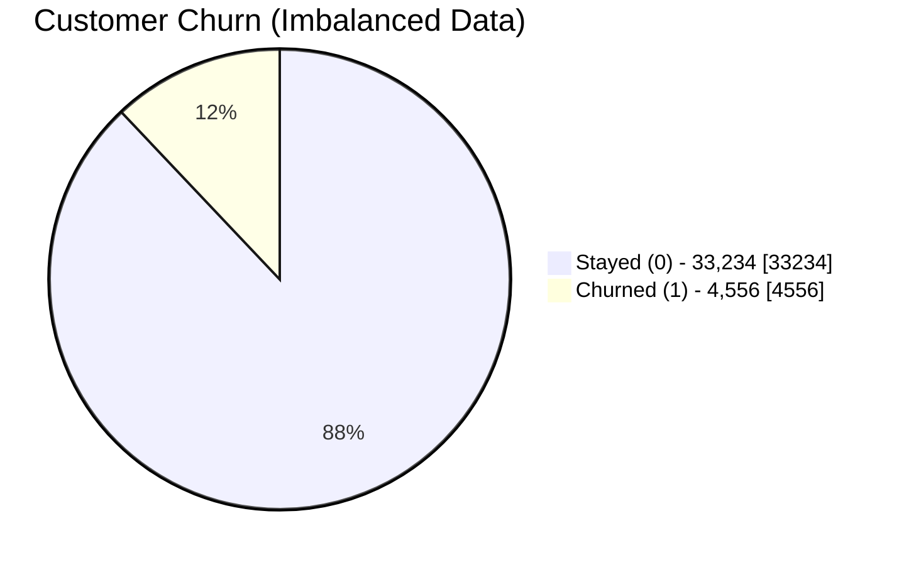
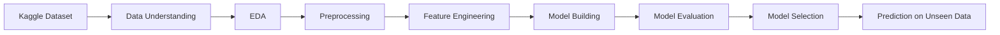
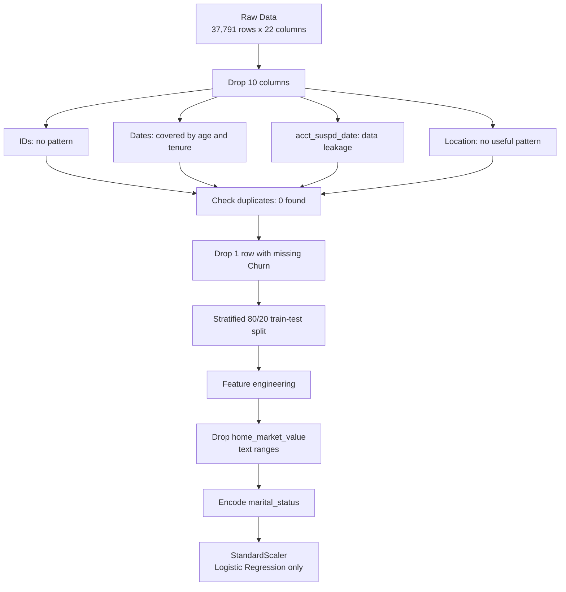
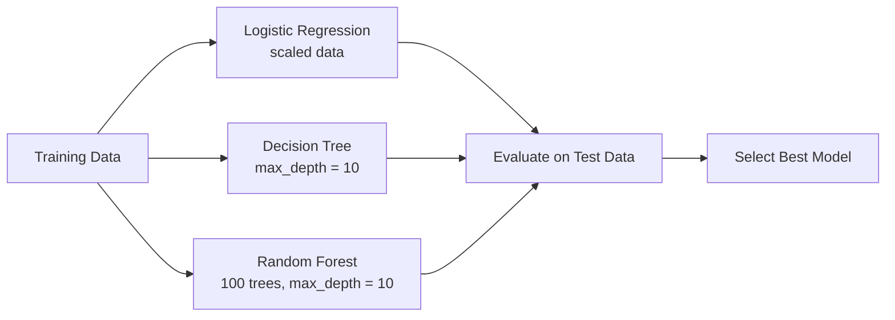
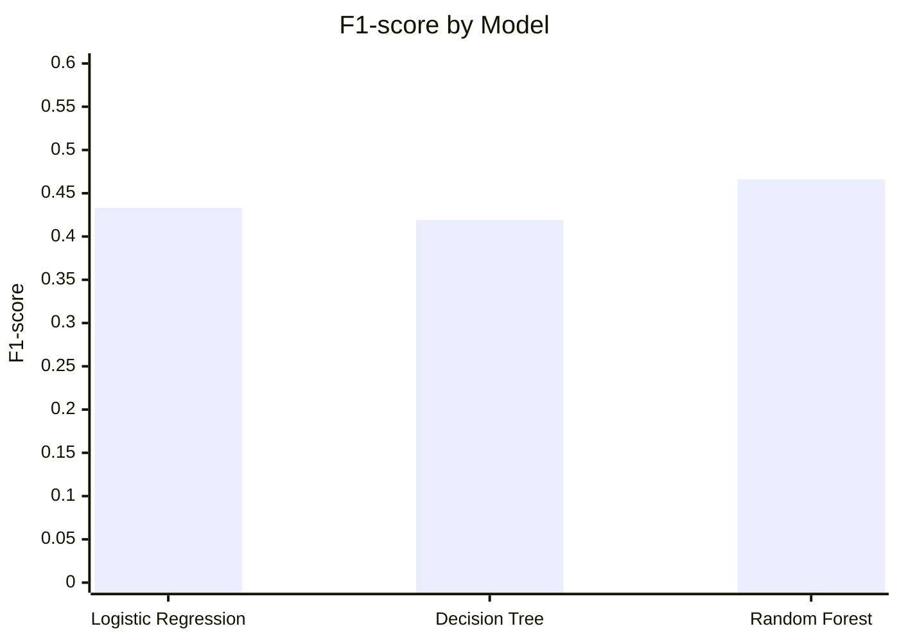
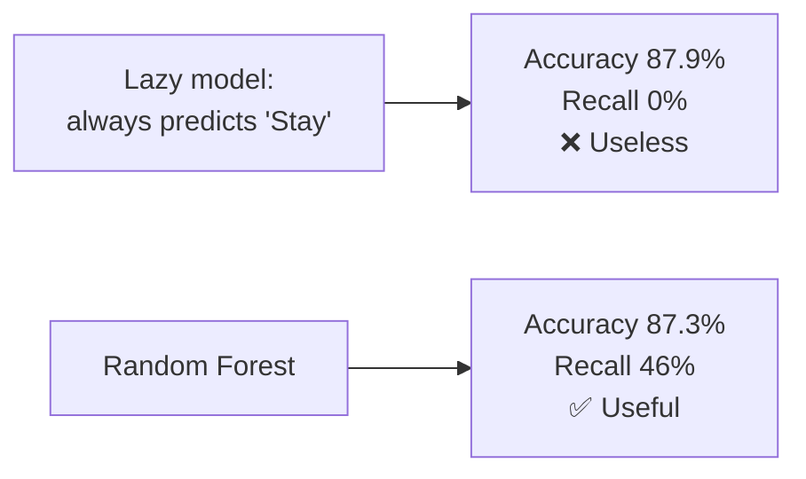
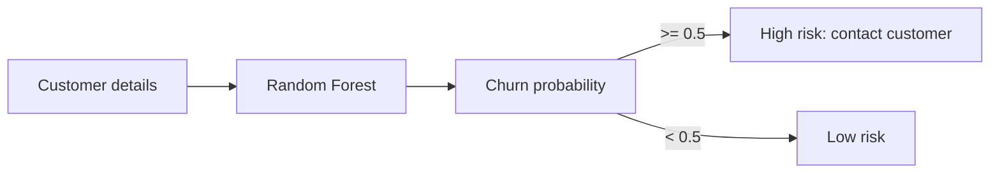

# 🛡️ Insurance Customer Churn Prediction

Predict which insurance customers are likely to **churn** (cancel or not renew their policy), so the company can step in early with retention offers.


---

## 📌 Problem Statement

Keeping an existing customer costs far less than winning a new one. This project builds a **binary classification** model that predicts whether a customer will churn:

- `Churn = 1` → customer left
- `Churn = 0` → customer stayed

---

## 📂 Dataset

| Item | Details |
|---|---|
| Source | [Kaggle – Auto Insurance Churn Analysis Dataset](https://www.kaggle.com/datasets/merishnasuwal/auto-insurance-churn-analysis-dataset) |
| File | `autoinsurance_churn.csv` |
| Rows used | 37,791 customers (subset), 37,790 after removing 1 incomplete row |
| Columns | 22 |
| Target | `Churn` |
| Type | Synthetic but realistic insurance customer data |

### Churn distribution



> Only **12.06%** of customers churned, so the data is **imbalanced**. A model that always predicts "stay" would already get 87.9% accuracy, so accuracy alone is misleading.

---

## 🔄 Project Workflow



---

## 🔍 Exploratory Data Analysis – Key Findings

| # | Finding |
|---|---|
| 1 | **Tenure is the strongest churn driver**: new customers churn the most |
| 2 | Marital status has almost no effect (single 12.3% vs married 11.9%) |
| 3 | `acct_suspd_date` is filled for **100% of churners and 0% of non-churners** → **data leakage** |
| 4 | `state` has only one value (TX), so it carries no information |
| 5 | County churn rates such as 46% come from very small groups, so they aren't reliable |
| 6 | Data-quality issues: age spike at ~55, tenure capped at ~17 years, income recorded in brackets |
| 7 | `individual_id` and `address_id` are almost identical and unrelated to churn |

---

## 🧹 Data Preprocessing



**Why the scaler is fitted after the split:** it learns its mean and standard deviation from the **training data only**, so no information leaks from the test set.

| Set | Rows | Churn rate |
|---|---|---|
| Train | 30,232 | 12.06% |
| Test | 7,558 | 12.05% |

---

## 🛠️ Feature Engineering

| New feature | How it is made | Why |
|---|---|---|
| `tenure_years` | `days_tenure / 365` | Easier to understand than days |
| `is_new_customer` | 1 if tenure < 365 days | New customers churn the most (from EDA) |

---

## 🤖 Models



| Model | Simple idea |
|---|---|
| Logistic Regression | Weighted sum of the features → probability (linear) |
| Decision Tree | A chain of yes/no questions |
| Random Forest | 100 decision trees vote together |

All models use `class_weight='balanced'`, so mistakes on churners count more and the class imbalance is handled.

---

## 📊 Results

| Model | Accuracy | Precision | Recall | F1-score |
|---|---|---|---|---|
| Logistic Regression | 0.840 | 0.378 | **0.507** | 0.433 |
| Decision Tree | 0.840 | 0.372 | 0.480 | 0.419 |
| **Random Forest** ⭐ | **0.873** | **0.473** | 0.460 | **0.466** |



### Random Forest – classification report (test set)

| Class | Precision | Recall | F1 | Support |
|---|---|---|---|---|
| 0 – Stayed | 0.93 | 0.93 | 0.93 | 6,647 |
| 1 – Churned | 0.47 | 0.46 | 0.47 | 911 |

The model catches about **46% of the customers who churn**, while keeping false alarms lower than the other models.

### Why not accuracy?



On imbalanced data, **recall** and **F1** matter more than accuracy. Missing a churner (false negative) costs more than a false alarm (false positive).

---

## 🏆 Model Selection

**Selected model: Random Forest**

1. Best F1-score (0.466), precision (0.473) and accuracy (0.873)
2. Captures non-linear patterns
3. More stable than a single Decision Tree because 100 trees vote together
4. Logistic Regression has slightly higher recall but far more false alarms (precision 0.378)

---

## 🎯 Prediction on Unseen Data

The final Random Forest outputs a **churn probability** for each customer with `predict_proba`. For example, the first 10 test customers got probabilities between 0.32 and 0.36. All were below the 0.5 threshold, so all were predicted to stay, and all 10 really stayed.



---

## 💡 Business Recommendations

- **Focus retention on new customers** (first year), the highest-risk group
- Score customers regularly and contact the highest-probability ones first
- Collect richer data (claims, complaints, payment delays) to improve predictions

---

## ⚠️ Limitations & Future Work

- Synthetic data, so real-world patterns may differ
- A 37.8k-row subset was used; training on the full dataset could change results slightly
- Features are only weakly related to churn, which limits performance
- Next steps: hyperparameter tuning, cross-validation, Gradient Boosting / XGBoost, threshold tuning, more behavioural features

---

## 🗂️ Repository Structure

```
├── Insurance_Churn_Prediction.ipynb   # Full notebook: data understanding → EDA → models → prediction
└── README.md                          # Project overview (this file)
```

> The dataset is not included in this repo. Download `autoinsurance_churn.csv` from the Kaggle link above.

---

## ▶️ How to Run

1. Clone the repo
   ```bash
   git clone https://github.com/sidhantds/insurance-churn-prediction.git
   ```
2. Install the libraries
   ```bash
   pip install pandas numpy matplotlib seaborn scikit-learn jupyter
   ```
3. Download `autoinsurance_churn.csv` from Kaggle and put it next to the notebook
4. Open `Insurance_Churn_Prediction.ipynb` in Jupyter or Google Colab and run all cells

---

## 🧰 Tech Stack

`Python` · `pandas` · `NumPy` · `Matplotlib` · `Seaborn` · `scikit-learn` · `Google Colab`

---

## 👤 Author

**Sidhant Pujara** · [GitHub](https://github.com/sidhantds)
